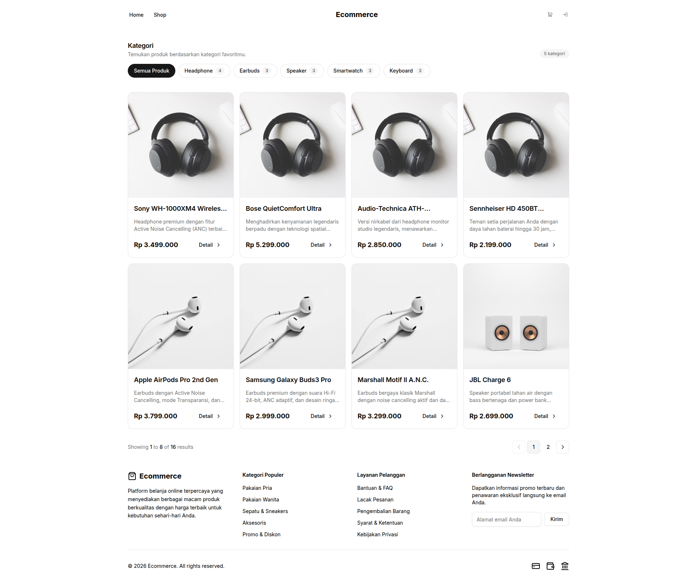
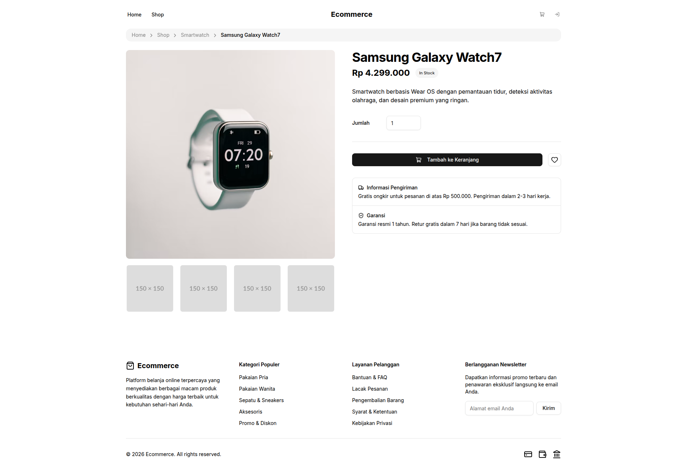
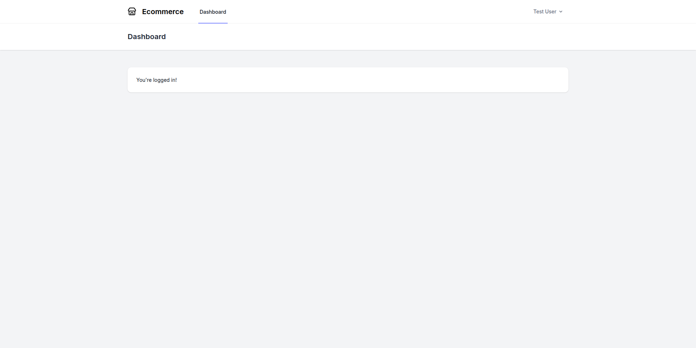
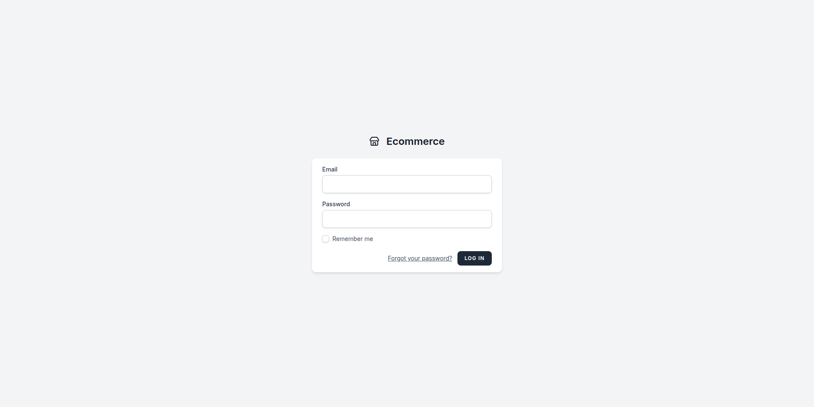
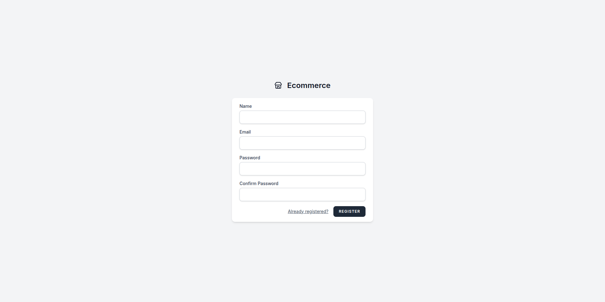
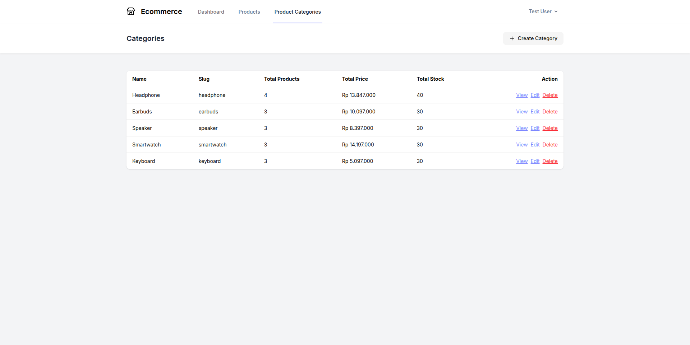
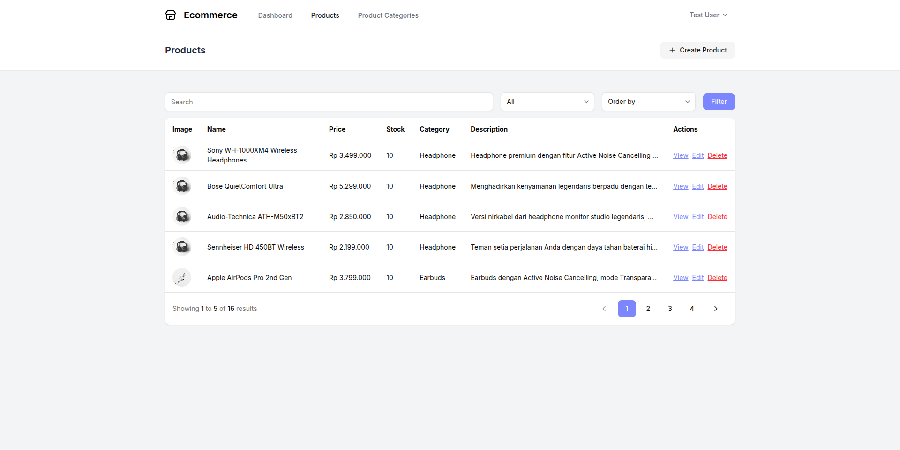

# E-Commerce Laravel : Tugas Sesi 10 - 16

## Deskripsi

Folder `ecommerce10` berisi proyek e-commerce berbasis Laravel yang dibangun secara bertahap mulai dari sesi 10 sampai sesi 16. Proyek dimulai dari pembuatan proyek Laravel dan route dasar, kemudian dilanjutkan dengan controller, halaman Blade, komponen tampilan, migration dan seeder data dummy, relasi model dan pagination data produk, penambahan fitur autentikasi menggunakan Laravel Breeze, hingga pembuatan halaman admin untuk pengelolaan produk dan kategori.

README ini disusun per sesi agar riwayat pengerjaan mudah dibaca dan dapat diperbarui ketika ada tugas sesi berikutnya.

## Daftar Tugas

| Sesi | Topik | Fokus |
| --- | --- | --- |
| 10 | Laravel Basics & Project Introduction with AI | Setup proyek Laravel, route dasar, model, dan controller awal |
| 11 | Blade Templating & Controller Essentials | Controller untuk mengelola produk dan halaman |
| 12 | Dynamic Page Creation | Halaman Blade dinamis dan komponen navbar/footer |
| 13 | Database Migration & Dummy Data Using AI | Migration tabel dan seeder data dummy |
| 14 | Eloquent Relationship & Pagination | Relasi model Product/ProductCategory, data produk dari database, dan pagination |
| 15 | Authentication with Laravel Breeze | Instalasi Laravel Breeze, login, registrasi, dan kustomisasi tampilan bawaan |
| 16 | Admin Product & Category Management | Menu navigasi, tabel daftar kategori dan produk, serta tombol tambah, edit, dan hapus |

## Tugas Sesi 10 : Laravel Basics & Project Introduction with AI

### Deskripsi

Membuat proyek Laravel baru untuk membangun website e-commerce, menyiapkan route dasar, mengonfigurasi database, serta membuat model dan controller awal untuk Product dan Order.

### Fitur

- Proyek Laravel baru dengan konfigurasi database SQLite.
- Route dasar: `/`, `/products`, `/cart`, dan `/checkout`.
- Route tambahan: `/shop`, `/product/{id}`, dan `/orders`.
- Model awal: `Product`, `ProductCategory`, `Cart`, `Order`, `OrderItem`, dan `User`.
- Controller awal untuk mengelola Product dan Order.
- Halaman katalog sementara menggunakan data dummy dari model `Product`.

### Dibangun Menggunakan

- Laravel 13
- PHP 8.3+
- SQLite

### File Terkait

```text
routes/web.php
app/Models/
app/Http/Controllers/
```

## Tugas Sesi 11 : Blade Templating & Controller Essentials

### Deskripsi

Menambahkan controller dasar untuk mengelola produk dan halaman, lalu memindahkan logika halaman dari route ke controller agar struktur aplikasi lebih rapi.

### Fitur

- `HomeController` untuk halaman utama, detail produk, dan keranjang.
- `ProductController` dan `ProductCategoryController` sebagai resource controller untuk pengelolaan produk dan kategori.
- `CartController`, `OrderController`, dan `OrderItemController` untuk alur keranjang dan pesanan.
- Route halaman diarahkan ke controller dan diberi nama route.

### Dibangun Menggunakan

- Laravel 13
- PHP 8.3+

### File Terkait

```text
app/Http/Controllers/HomeController.php
app/Http/Controllers/ProductController.php
app/Http/Controllers/ProductCategoryController.php
app/Http/Controllers/CartController.php
app/Http/Controllers/OrderController.php
app/Http/Controllers/OrderItemController.php
routes/web.php
```

## Tugas Sesi 12 : Dynamic Page Creation

### Deskripsi

Membuat halaman-halaman dinamis menggunakan Blade dan menampilkan data yang dikirim dari controller, serta memisahkan bagian tampilan yang berulang menjadi komponen Blade.

### Fitur

- Halaman utama dan daftar produk (`/`, `/shop`, `/products`) dengan grid kartu produk.
- Halaman detail produk (`/product/{id}`) dengan breadcrumb.
- Halaman keranjang belanja (`/cart`).
- Layout Blade yang dapat digunakan ulang oleh semua halaman.
- Komponen Blade untuk navbar, footer, product card, breadcrumb, dan alert.
- Styling menggunakan Tailwind CSS 4, aset shadcn HTML, ikon Lucide, dan Vite.

### Dibangun Menggunakan

- Laravel Blade
- Tailwind CSS 4
- Vite
- JavaScript (Lucide Icons)

### File Terkait

```text
resources/views/home/index.blade.php
resources/views/product/description.blade.php
resources/views/cart/index.blade.php
resources/views/components/header.blade.php
resources/views/components/footer.blade.php
resources/views/components/layout-component.blade.php
resources/views/components/product-card.blade.php
resources/views/components/breadcrumb.blade.php
resources/views/components/alert.blade.php
app/View/Components/
```

## Tugas Sesi 13 : Database Migration & Dummy Data Using AI

### Deskripsi

Membuat migration untuk struktur tabel e-commerce dan seeder untuk mengisi data dummy produk dan kategori agar halaman memiliki data awal yang dapat diuji.

### Fitur

- Migration tabel `product_categories`, `products`, `carts`, `orders`, dan `order_items`.
- Foreign key untuk menghubungkan produk dengan kategori, keranjang dengan pengguna/produk, serta pesanan dengan item pesanan.
- Seeder `ProductCategorySeeder` untuk 5 kategori: Headphone, Earbuds, Speaker, Smartwatch, dan Keyboard.
- Seeder `ProductSeeder` untuk 16 produk dummy dengan minimal 3 produk pada setiap kategori.
- `DatabaseSeeder` menjalankan seeder produk dan aman dijalankan berulang tanpa membuat data ganda.

Catatan: pada implementasi ini, detail produk dalam pesanan disimpan di tabel `order_items`, sehingga satu pesanan dapat memiliki lebih dari satu produk.

### Dibangun Menggunakan

- Laravel Migration
- Laravel Seeder
- Eloquent ORM
- SQLite / MySQL

### File Terkait

```text
database/migrations/
├── 0001_01_01_000000_create_users_table.php
├── 0001_01_01_000001_create_cache_table.php
├── 0001_01_01_000002_create_jobs_table.php
├── 2026_10_23_135642_create_product_categories_table.php
├── 2026_10_23_135643_create_products_table.php
├── 2026_10_23_135644_create_carts_table.php
├── 2026_10_23_135645_create_orders_table.php
└── 2026_10_23_135646_create_order_items_table.php

database/seeders/
├── DatabaseSeeder.php
├── ProductCategorySeeder.php
└── ProductSeeder.php
```

## Tugas Sesi 14 : Eloquent Relationship & Pagination




### Deskripsi

Menghubungkan model menggunakan relasi Eloquent, lalu menampilkan data produk dari database menggunakan controller dan Blade. Daftar produk dibatasi dengan pagination agar data yang tampil dalam satu halaman tetap rapi. Mulai sesi 14, proyek menggunakan database MySQL.

### Fitur

- Model `Product` dengan relasi `category()`, `carts()`, dan `orderItems()`, serta model `ProductCategory` dengan relasi `products()`.
- Relasi pendukung antar model: `Cart` ke `User`/`Product`/`Order`, `Order` ke `User`/`Cart`/`OrderItem`, `OrderItem` ke `Order`/`Product`, dan `User` ke `Cart`/`Order`.
- `HomeController@index` mengambil produk dari database dengan `paginate(8)` dan `withQueryString()`, mendukung filter kategori lewat query `?category=slug`, serta mengirim daftar kategori dengan jumlah produknya (`withCount('products')`).
- `ProductController@show` menampilkan detail produk berdasarkan route model binding beserta breadcrumb kategori.
- Halaman home menampilkan daftar kategori yang dapat diklik dan grid produk dengan komponen `product-card`.
- Pagination Tailwind pada halaman daftar produk.
- Data dummy hardcoded pada model `Product` dihapus dan diganti data dari database hasil seeder.
- Seeder produk menggunakan gambar berbeda untuk setiap kategori (headphone, earbuds, speaker, smartwatch, keyboard).

### Dibangun Menggunakan

- Eloquent ORM
- MySQL
- Route Model Binding
- Laravel Pagination
- Laravel Blade
- Tailwind CSS 4

### File Terkait

```text
app/Models/Product.php
app/Models/ProductCategory.php
app/Models/Cart.php
app/Models/Order.php
app/Models/OrderItem.php
app/Models/User.php
app/Http/Controllers/HomeController.php
app/Http/Controllers/ProductController.php
app/Http/Controllers/CartController.php
resources/views/home/index.blade.php
resources/views/product/description.blade.php
resources/views/vendor/pagination/tailwind.blade.php
resources/views/vendor/pagination/simple-tailwind.blade.php
database/seeders/ProductSeeder.php
routes/web.php
```

## Tugas Sesi 15 : Authentication with Laravel Breeze





### Deskripsi

Menginstal Laravel Breeze untuk menambahkan fitur autentikasi seperti login dan registrasi, kemudian menyesuaikan file Blade bawaan Breeze agar sesuai dengan identitas aplikasi e-commerce ini. Fitur autentikasi ini menggunakan database MySQL yang sama dengan tugas sesi 14.

### Fitur

- Instalasi Laravel Breeze dengan stack Blade untuk fitur autentikasi.
- Halaman login, registrasi, lupa password, reset password, verifikasi email, dan konfirmasi password.
- Fitur logout, dashboard untuk pengguna yang sudah login, serta pengelolaan profil (ubah data profil, ubah password, dan hapus akun).
- Route autentikasi dipisahkan pada `routes/auth.php`, sedangkan route dashboard dan profil dilindungi middleware `auth` dan `verified`.
- Kustomisasi tampilan bawaan Breeze: logo aplikasi diganti ikon toko (Lucide `store`) dan nama situs menggunakan `config('app.name')` dengan nilai `Ecommerce`.
- Penyesuaian halaman `welcome`, layout guest, navigation bar, serta komponen Blade bawaan Breeze agar selaras dengan tema aplikasi.
- Dependency frontend Breeze: Alpine.js dan `@tailwindcss/forms`.
- Test fitur autentikasi dan profil dari Breeze.

### Dibangun Menggunakan

- Laravel Breeze 2
- Laravel Blade
- Alpine.js
- Tailwind CSS 4
- `@tailwindcss/forms`
- MySQL
- Vite

### File Terkait

```text
app/Http/Controllers/Auth/
app/Http/Controllers/ProfileController.php
app/Http/Requests/Auth/LoginRequest.php
app/Http/Requests/ProfileUpdateRequest.php
app/View/Components/AppLayout.php
app/View/Components/GuestLayout.php
app/Models/User.php
routes/auth.php
routes/web.php
resources/views/auth/
resources/views/layouts/
resources/views/profile/
resources/views/components/application-logo.blade.php
resources/views/dashboard.blade.php
resources/views/welcome.blade.php
resources/css/app.css
resources/js/app.js
tests/Feature/Auth/
tests/Feature/ProfileTest.php
```

## Tugas Sesi 16 : Admin Product & Category Management




### Deskripsi

Menambahkan menu navigasi menuju halaman daftar kategori dan produk, lalu membuat halaman admin untuk menampilkan data produk dan kategori dalam bentuk tabel beserta tombol tambah, edit, dan hapus.

### Fitur

- Menu navigasi `Products` dan `Product Categories` pada navigation bar untuk pengguna yang sudah login.
- Route resource `products` dan `product-categories` di bawah prefix `/dashboard`, dilindungi middleware `auth` dan `verified`.
- Halaman daftar kategori menampilkan tabel berisi nama, slug, jumlah produk, total harga, dan total stok produk pada setiap kategori.
- Halaman daftar kategori menyediakan tombol `Create Category`, `View`, `Edit`, dan `Delete`.
- Halaman daftar produk menampilkan tabel berisi gambar, nama, harga, stok, kategori, dan deskripsi produk.
- Halaman daftar produk menyediakan tombol `Create Product`, `View`, `Edit`, dan `Delete`.
- Pencarian produk berdasarkan nama, filter berdasarkan kategori, serta pengurutan berdasarkan nama, harga, dan stok (naik/turun).
- Pagination 5 produk per halaman dan query filter tetap terbawa saat berpindah halaman.
- Perhitungan jumlah produk, total harga, dan total stok kategori menggunakan `withCount()` dan `withSum()`.
- Penyesuaian tampilan pagination Tailwind menggunakan style tombol aplikasi.

### Dibangun Menggunakan

- Laravel Resource Controller
- Eloquent ORM (`withCount`, `withSum`)
- MySQL
- Laravel Blade
- Tailwind CSS 4
- Lucide Icons

### File Terkait

```text
app/Http/Controllers/ProductController.php
app/Http/Controllers/ProductCategoryController.php
resources/views/admin/categories/index.blade.php
resources/views/admin/products/index.blade.php
resources/views/layouts/navigation.blade.php
resources/views/vendor/pagination/tailwind.blade.php
routes/web.php
```

## Cara Menjalankan

Pastikan PHP 8.3+, Composer, Node.js, npm, dan MySQL sudah terpasang. Sejak tugas sesi 14, proyek menggunakan database MySQL.

Buat database MySQL terlebih dahulu:

```bash
mysql -u root -p -e "CREATE DATABASE ecommerce10;"
```

```bash
composer install
cp .env.example .env
php artisan key:generate
```

Sesuaikan konfigurasi database pada file `.env` (`.env.example` masih menggunakan SQLite):

```dotenv
DB_CONNECTION=mysql
DB_HOST=127.0.0.1
DB_PORT=3306
DB_DATABASE=ecommerce10
DB_USERNAME=root
DB_PASSWORD=
```

Setelah konfigurasi database benar, jalankan migration dan frontend:

```bash
php artisan migrate --seed
npm install
npm run dev
```

Jalankan server Laravel pada terminal terpisah:

```bash
php artisan serve
```

Kemudian buka `http://127.0.0.1:8000` di browser. Halaman login tersedia di `/login`, registrasi di `/register`, dan dashboard pengguna di `/dashboard`.

Untuk menjalankan ulang seeder:

```bash
php artisan db:seed
```

## Struktur Proyek

```text
ecommerce10/
├── app/
│   ├── Http/Controllers/       # Controller halaman, produk, kategori, cart, order, auth, dan profil
│   ├── Http/Requests/          # Form request validasi auth dan profil
│   ├── Models/                 # Model Eloquent beserta relasinya
│   └── View/Components/        # Class komponen Blade (termasuk layout Breeze)
├── database/
│   ├── migrations/             # Struktur tabel database
│   └── seeders/                # Data dummy produk dan kategori
├── resources/
│   ├── css/app.css             # Style Tailwind CSS
│   ├── js/app.js               # Entry point JavaScript
│   └── views/
│       ├── components/         # Navbar, footer, layout, product card, dll.
│       ├── home/               # Halaman utama dan daftar produk (dengan filter & pagination)
│       ├── product/            # Halaman detail produk
│       ├── cart/               # Halaman keranjang
│       ├── admin/              # Halaman admin daftar produk dan kategori
│       ├── auth/               # Halaman login, registrasi, dan reset password
│       ├── layouts/            # Layout aplikasi dan guest dari Breeze
│       ├── profile/            # Halaman pengelolaan profil
│       └── vendor/pagination/  # Template pagination Tailwind
├── routes/web.php              # Definisi route utama
├── routes/auth.php             # Definisi route autentikasi
├── composer.json               # Dependency PHP
├── package.json                # Dependency frontend
├── vite.config.js              # Konfigurasi Vite
└── README.md
```