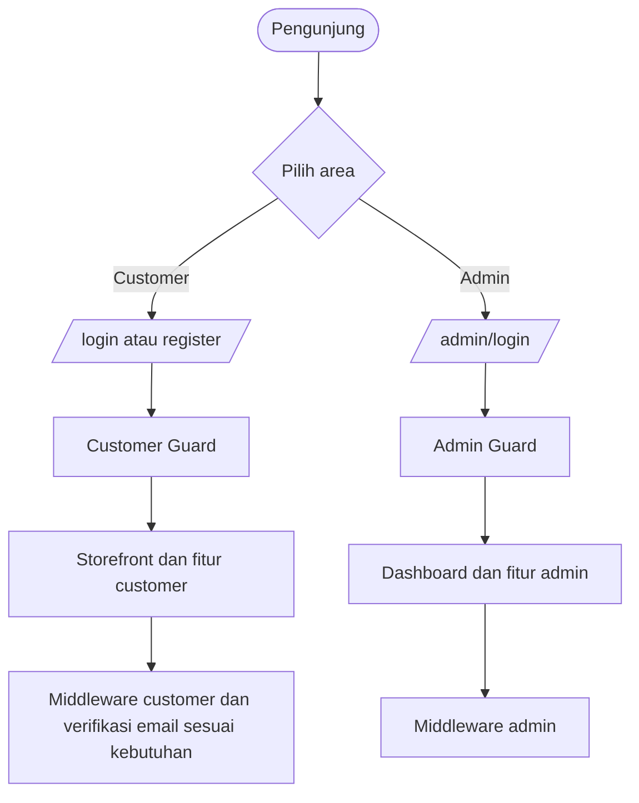
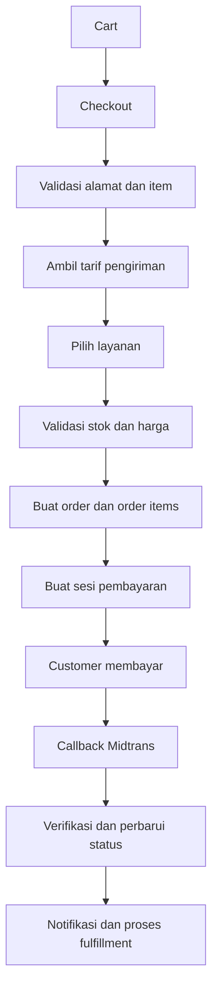
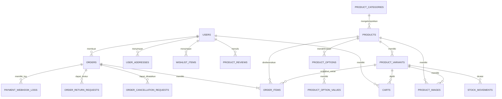

# Materi Presentasi — E-Commerce Website

> **Project:** E-Commerce Website
> **Repository:** `/home/user/GitHub/eduwork-batch-10/ecommerce10`
> **Dokumen:** `docs/PRESENTATION.md`
> **Tujuan:** Materi sumber untuk disusun menjadi slide PowerPoint.
> **Acuan:** Struktur route, controller, service, model, migration, dan Blade view pada repository saat ini.
> **Catatan screenshot:** Placeholder menunjukkan halaman yang perlu diambil dari aplikasi aktual. Simpan hasilnya di `docs/screenshots/` menggunakan nama file yang dicantumkan.

---

## Slide 1 — Judul Project

# E-Commerce Website

**Platform toko online untuk mengelola katalog, varian produk, transaksi pembayaran, persediaan, dan pengiriman dalam satu aplikasi.**

- Nama Project: E-Commerce Website
- Nama Pembuat: [Nama Lengkap]
- Program: Eduwork — Batch 10
- Teknologi Utama: Laravel 13, PHP 8.3+, MySQL, Blade, Tailwind CSS 4

**Visual:**
- [PLACEHOLDER: Screenshot halaman Home sebagai background/hero]
- Sumber: `resources/views/home/index.blade.php`
- File: `docs/screenshots/01-homepage.png`

---

## Slide 2 — Deskripsi Project & Fitur Utama

### Deskripsi Singkat

E-Commerce Website merupakan aplikasi toko online berbasis web yang menyediakan pengalaman belanja untuk customer dan area operasional terpisah untuk admin. Customer dapat menjelajahi produk beserta variannya, menyimpan wishlist, mengelola alamat, melakukan checkout, membayar pesanan, serta memantau proses pengiriman. Admin mengelola katalog, stok, pesanan, pengguna, dan proses operasional toko.

### Fitur Customer

- Melihat halaman utama, katalog, kategori, pencarian, dan detail produk.
- Memilih varian produk dengan opsi seperti warna dan ukuran.
- Melihat galeri gambar, harga, stok, dan informasi produk.
- Registrasi, login, verifikasi email, reset password, dan pengelolaan profil.
- Menambahkan produk ke keranjang dan memperbarui kuantitas.
- Mengelola wishlist dan alamat pengiriman.
- Memilih wilayah alamat Indonesia secara bertingkat.
- Melihat estimasi/opsi pengiriman pada proses checkout.
- Membuat pesanan dan membayar melalui payment gateway.
- Melihat riwayat pesanan, invoice, status pembayaran, dan pelacakan pengiriman.
- Mengajukan pembatalan atau retur, mengirim revisi bukti, dan mengonfirmasi pesanan diterima.
- Menerima notifikasi dan menulis ulasan produk.

### Fitur Admin

- Login admin dengan guard dan halaman autentikasi tersendiri.
- Dashboard ringkasan dan analitik toko.
- CRUD produk, kategori, gambar, opsi, dan varian.
- Mengelola SKU, barcode, harga, harga pembanding, biaya, stok, dan dimensi.
- Mencatat pergerakan stok melalui inventory management.
- Mengelola customer/admin dan ulasan produk.
- Melihat seluruh pesanan dan memperbarui status pesanan.
- Memproses pembatalan, retur, dan refund sesuai alur yang tersedia.
- Memantau rekonsiliasi pembayaran dan pengiriman.
- Melihat audit aktivitas admin/customer serta log pengiriman email.
- Mengelola notifikasi dan melakukan retry pengiriman email yang gagal.

### Integrasi Eksternal

- **Midtrans:** pembuatan sesi pembayaran, callback/webhook, status transaksi, rekonsiliasi, dan proses refund yang didukung alur pembatalan.
- **Biteship:** pencarian tarif pengiriman, pembuatan pengiriman, webhook, tracking, dan rekonsiliasi status pengiriman.
- **Email:** pengiriman email transaksional dan pencatatan status delivery.

---

## Slide 3 — Teknologi, Framework & Tools

### Backend

- **PHP 8.3+** — Bahasa pemrograman backend.
- **Laravel 13** — Routing, middleware, validasi, autentikasi, queue/scheduler, dan fondasi aplikasi.
- **Eloquent ORM** — Relasi dan pengelolaan data database.
- **MySQL** — Database relasional.
- **Midtrans PHP SDK** — Integrasi transaksi pembayaran.
- **Laravel DomPDF** — Pembuatan invoice PDF.
- **Laravel Wilayah** — Data wilayah administratif Indonesia.

### Frontend

- **Blade** — Template halaman dan komponen UI.
- **Tailwind CSS 4** — Styling dan responsive layout.
- **Alpine.js** — Interaksi UI.
- **Vite** — Build tool dan development server.
- **Chart.js** — Visualisasi data dashboard.
- **Lucide** — Ikon antarmuka.
- **Axios** — HTTP request dari frontend.
- **Laravel Precognition** — Validasi form sebelum submit penuh.
- **Pristine.js** — Validasi form sisi client pada bagian yang menggunakannya.
- **NProgress** — Indikator progres navigasi.

### Development & Testing

- Visual Studio Code
- Composer dan npm
- Laravel Artisan
- Pest — Feature dan integration-oriented testing
- Browser untuk pengujian UI

**File konfigurasi utama:**
- `composer.json`
- `package.json`
- `vite.config.js`
- `bootstrap/app.php`
- `routes/web.php`
- `routes/auth.php`

---

## Slide 4 — Wireframe & Tampilan Aplikasi

Gunakan screenshot aplikasi aktual. Path di bawah merupakan sumber halaman, bukan teks yang perlu dimasukkan ke slide final.

### Customer / Storefront

| Halaman | Route | View | File Screenshot |
|---|---|---|---|
| Home | `/` | `resources/views/home/index.blade.php` | `02-home-page.png` |
| Shop | `/shop` | `resources/views/home/shop.blade.php` | `03-shop-page.png` |
| Product detail | `/product/{product:slug}` | `resources/views/product/description.blade.php` | `04-product-detail.png` |
| Cart | `/cart` | `resources/views/cart/index.blade.php` | `05-cart-page.png` |
| Checkout | `GET /checkout` mengarahkan customer kembali ke cart; proses checkout dilakukan dari halaman cart | `resources/views/cart/index.blade.php` | `06-checkout.png` |
| Order detail | `/orders/{order}` | `resources/views/orders/show.blade.php` | `07-order-detail.png` |
| Wishlist | `/wishlist` | `resources/views/wishlist/index.blade.php` | `08-wishlist.png` |
| Address | `/addresses` | `resources/views/addresses/` | `09-addresses.png` |
| Login / Register | `/login`, `/register` | `resources/views/auth/` | `10-authentication.png` |

### Admin

| Halaman | Route | View | File Screenshot |
|---|---|---|---|
| Admin login | `/admin/login` | `resources/views/admin/auth/login.blade.php` | `11-admin-login.png` |
| Dashboard | `/dashboard` | `resources/views/admin/dashboard.blade.php` | `12-admin-dashboard.png` |
| Product list & detail | `/dashboard/products` | `resources/views/admin/products/` | `13-admin-products.png` |
| Product variants | `/dashboard/products/{product}/edit` | `resources/views/admin/products/edit.blade.php` | `14-admin-product-variants.png` |
| Inventory | `/dashboard/inventory` | `resources/views/admin/inventory/index.blade.php` | `15-admin-inventory.png` |
| Orders | `/dashboard/orders` | `resources/views/admin/orders/` | `16-admin-orders.png` |
| Payment reconciliation | `/dashboard/payment-reconciliation` | `resources/views/admin/payment-reconciliation/index.blade.php` | `17-payment-reconciliation.png` |
| Shipping reconciliation | `/dashboard/biteship-reconciliation` | `resources/views/admin/biteship-reconciliation/index.blade.php` | `18-shipping-reconciliation.png` |
| User management | `/dashboard/users` | `resources/views/admin/users/` | `19-admin-users.png` |
| Activity & delivery logs | `/dashboard/activity-logs`, `/dashboard/email-delivery-logs` | `resources/views/admin/activity-logs/`, `resources/views/admin/email-delivery-logs/` | `20-admin-monitoring.png` |

---

## Slide 5 — Arsitektur Aplikasi & Autentikasi

### Pemisahan Area Customer dan Admin

Aplikasi menggunakan guard autentikasi terpisah untuk customer dan admin. Halaman login keduanya juga terpisah, sehingga sesi dan hak akses tidak tercampur.

- Customer: `/login`, `/register`, dan `/logout`.
- Admin: `/admin/login` dan `/admin/logout`.
- Area admin berada di prefix `/dashboard` dan dilindungi middleware autentikasi serta otorisasi admin.
- Route customer menggunakan middleware customer; operasi tertentu juga mensyaratkan email terverifikasi.
- Pengguna yang sudah login diarahkan dari halaman login yang bukan untuk guard-nya ke area yang sesuai.

### Route Utama

Sumber: `routes/web.php` dan `routes/auth.php`.

| Area | Route penting | Fungsi |
|---|---|---|
| Storefront | `/`, `/shop`, `/product/{product:slug}` | Home, katalog, detail produk |
| Cart | `/cart`, `POST /cart/{product}` | Keranjang |
| Checkout | `GET /checkout`, `POST /checkout` | Checkout dan pembuatan pesanan |
| Payment | `POST /orders/{order}/payment`, `POST /midtrans/callback` | Inisiasi dan callback pembayaran |
| Customer | `/orders`, `/addresses`, `/wishlist`, `/profile` | Akun dan aktivitas customer |
| Admin | `/admin/login`, `/dashboard` | Autentikasi dan area admin |
| Webhook | `/webhooks/biteship` | Pembaruan status pengiriman dari provider |

### Diagram Autentikasi dan Area Aplikasi



**Sumber screenshot kode:** `routes/web.php`, `routes/auth.php`, `config/auth.php`, dan middleware di `app/Http/Middleware/`.

---

## Slide 6 — Katalog Produk, Varian & Inventory

### Pengelolaan Produk

Data produk mencakup informasi katalog dan operasional, antara lain:

- Nama, slug, deskripsi, kategori, dan status aktif/featured.
- Galeri gambar dengan gambar utama.
- SKU dan barcode.
- Harga jual, harga pembanding, dan harga modal.
- SEO title dan SEO description.
- Berat serta dimensi untuk kebutuhan pengiriman.
- Jumlah klik/kunjungan detail produk.

### Varian Produk

Produk dapat memiliki beberapa varian, misalnya kombinasi warna dan ukuran.

- Opsi dan nilai opsi dikelola melalui product options.
- Setiap kombinasi varian memiliki SKU, barcode, harga, stok, berat, dan dimensi.
- Varian dapat memiliki gambar tersendiri.
- Warna dapat menyimpan kode warna HEX agar storefront dapat menampilkan swatch warna yang sesuai.
- Produk lama tetap didukung melalui varian default/legacy yang dibuat untuk menjaga kompatibilitas.

### Inventory

- Stok dikelola pada tingkat varian.
- Admin dapat mencatat penambahan atau pengurangan stok.
- Pergerakan stok disimpan sebagai inventory/stock movement.
- Perubahan stok saat transaksi dilakukan melalui service inventory agar pencatatan lebih konsisten.
- Data stok agregat produk digunakan untuk kebutuhan ringkasan katalog.

**Sumber kode:**
- `app/Models/Product.php`
- `app/Models/ProductVariant.php`
- `app/Models/ProductOption.php`
- `app/Models/ProductOptionValue.php`
- `app/Models/ProductImage.php`
- `app/Services/InventoryService.php`
- `app/Http/Controllers/ProductController.php`
- `app/Http/Controllers/InventoryController.php`

**Visual:**
- [PLACEHOLDER: Product editor dengan tab variants & inventory]
- [PLACEHOLDER: Storefront color swatches dan pemilih varian]
- File: `docs/screenshots/14-admin-product-variants.png`

---

## Slide 7 — Cart, Checkout & Pembayaran

### Keranjang Belanja

1. Customer menambahkan produk/varian ke keranjang.
2. Sistem memvalidasi kuantitas dan ketersediaan stok.
3. Customer dapat mengubah kuantitas atau menghapus item.
4. Total belanja dihitung dari item yang ada di keranjang.
5. Aksi perubahan cart dibatasi pada customer yang memiliki item tersebut.

### Checkout

1. Customer harus login dan memenuhi persyaratan verifikasi email.
2. Customer memulai checkout dari halaman cart dan memilih alamat pengiriman.
3. Sistem meminta opsi tarif pengiriman berdasarkan tujuan dan detail barang.
4. Customer memilih layanan pengiriman.
5. Sistem memvalidasi ulang item, harga, dan stok sebelum membuat pesanan.
6. Pesanan dan snapshot item disimpan dalam transaksi database.
7. Customer diarahkan ke detail pesanan untuk melanjutkan pembayaran.

### Pembayaran

- Integrasi Midtrans digunakan untuk membuat sesi/transaction token pembayaran.
- Status pembayaran diperbarui berdasarkan callback/notifikasi yang diverifikasi.
- Halaman sukses dan gagal pembayaran tersedia.
- Data transaksi disimpan pada order untuk mendukung pemeriksaan status dan rekonsiliasi.
- Masa berlaku pembayaran yang belum selesai ditangani oleh proses otomatis.
- Alur pembatalan yang memenuhi ketentuan dapat memproses refund melalui API, kemudian menyimpan referensi dan status refund.

### Diagram Checkout



**Sumber kode:**
- `app/Http/Controllers/CartController.php`
- `app/Http/Controllers/OrderController.php`
- `app/Http/Controllers/PaymentController.php`
- `app/Services/MidtransPaymentService.php`
- `app/Services/InventoryService.php`
- `resources/views/cart/index.blade.php`
- `resources/views/orders/`
- `resources/views/payments/`

**Visual:** [PLACEHOLDER: Halaman cart dengan form alamat, pilihan pengiriman, dan ringkasan checkout]
File: `docs/screenshots/06-checkout.png`

---

## Slide 8 — Pesanan, Pengiriman, Pembatalan & Retur

### Pengelolaan Pesanan

- Setiap pesanan memiliki nomor order, customer, item snapshot, nilai transaksi, dan status.
- Customer hanya dapat melihat pesanan miliknya.
- Admin dapat melihat seluruh pesanan dan memperbarui status melalui halaman detail.
- Customer dapat mengunduh invoice PDF.
- Customer dapat mengonfirmasi bahwa pesanan telah diterima.

### Fulfillment & Tracking

- Tarif pengiriman diperoleh pada proses checkout.
- Data pengiriman diproses melalui integrasi Biteship.
- Status pengiriman dapat diperbarui melalui webhook dan pemeriksaan ulang.
- Customer dapat melihat informasi pelacakan pada halaman detail pesanan.
- Admin memiliki halaman rekonsiliasi untuk memeriksa pesanan yang status pengirimannya perlu diselaraskan.

### Pembatalan & Refund

- Customer mengajukan permintaan pembatalan dari pesanan yang memenuhi syarat.
- Admin meninjau dan memproses permintaan sesuai status pesanan dan pembayaran.
- Jika refund diperlukan, proses refund dijalankan melalui integrasi pembayaran dan hasilnya dicatat.
- Bukti refund dapat ditampilkan kepada pihak yang berwenang.

### Retur

- Customer mengajukan retur dan melampirkan bukti.
- Admin dapat meninjau, meminta revisi, menerima barang retur, dan menentukan penyelesaian.
- Customer dapat mengirim revisi bukti dan informasi pengiriman balik.
- Status dan tahapan penyelesaian dicatat agar proses dapat ditelusuri.

**Sumber kode:**
- `app/Http/Controllers/OrderController.php`
- `app/Http/Controllers/OrderCancellationRequestController.php`
- `app/Http/Controllers/OrderReturnRequestController.php`
- `app/Services/BiteshipShippingService.php`
- `app/Http/Controllers/BiteshipWebhookController.php`
- `resources/views/orders/show.blade.php`
- `resources/views/admin/orders/show.blade.php`
- `docs/ORDER-FULFILLMENT.md`
- `docs/ORDER-CANCELLATION.md`

**Visual:**
- [PLACEHOLDER: Detail pesanan customer dengan status dan tracking]
- [PLACEHOLDER: Detail pesanan admin dengan tindakan operasional]
- File: `docs/screenshots/07-order-detail.png` dan `docs/screenshots/16-admin-orders.png`

---

## Slide 9 — Dashboard & Operasional Admin

### Dashboard

Dashboard admin menyajikan ringkasan performa dan aktivitas toko, seperti metrik katalog, pesanan, dan visualisasi data operasional yang tersedia.

### Modul Admin

| Modul | Fungsi |
|---|---|
| Products | CRUD produk, gambar, opsi, varian, dan informasi katalog |
| Categories | CRUD kategori produk |
| Inventory | Penyesuaian stok dan riwayat pergerakan stok |
| Orders | Daftar pesanan, detail, dan pembaruan status |
| Users | Pengelolaan akun admin/customer sesuai kewenangan |
| Reviews | Moderasi dan pengelolaan ulasan |
| Payment reconciliation | Pemeriksaan transaksi dan penyelesaian ketidaksesuaian |
| Biteship reconciliation | Pemeriksaan dan retry proses/status pengiriman |
| Activity logs | Riwayat aktivitas admin dan customer |
| Email delivery logs | Status pengiriman email dan retry yang tersedia |
| Notifications | Notifikasi operasional untuk admin |

### Monitoring Transaksi

- Rekonsiliasi pembayaran dapat memeriksa kembali status transaksi ke provider.
- Perbedaan status dapat ditampilkan sebagai alert untuk ditinjau admin.
- Penyelesaian ketidaksesuaian dicatat sebagai bagian dari audit.
- Rekonsiliasi pengiriman membantu menemukan status order yang belum sinkron.
- Log webhook pembayaran, pengiriman, aktivitas, dan email mendukung investigasi.

**Sumber kode:**
- `app/Http/Controllers/DashboardController.php`
- `app/Http/Controllers/InventoryController.php`
- `app/Http/Controllers/PaymentReconciliationController.php`
- `app/Http/Controllers/BiteshipReconciliationController.php`
- `app/Http/Controllers/AdminActivityLogController.php`
- `app/Http/Controllers/CustomerActivityLogController.php`
- `app/Http/Controllers/EmailDeliveryLogController.php`

**Visual:** [PLACEHOLDER: Dashboard dan halaman rekonsiliasi]
File: `docs/screenshots/12-admin-dashboard.png`, `17-payment-reconciliation.png`, `18-shipping-reconciliation.png`

---

## Slide 10 — Database & Entity Relationship

### Entitas Utama

Struktur database berkembang dari transaksi dasar menjadi modul katalog, pembayaran, fulfillment, audit, dan operasional. Entitas penting meliputi:

- **users** — akun customer dan admin dengan role.
- **product_categories** — kategori produk.
- **products** — data utama katalog.
- **product_variants** — SKU/varian, harga, stok, dan dimensi per varian.
- **product_options** dan **product_option_values** — definisi opsi serta nilai varian.
- **product_images** — galeri gambar produk/varian.
- **carts** — item keranjang customer.
- **orders** dan **order_items** — transaksi dan snapshot item.
- **user_addresses** — alamat customer.
- **wishlist_items** — daftar produk yang disimpan customer.
- **product_reviews** dan **product_review_media** — ulasan dan media.
- **stock_movements** — histori perubahan stok.
- **order_cancellation_requests** dan **order_return_requests** — alur pembatalan dan retur.
- **payment_webhook_logs**, **payment_reconciliation_checks**, dan entitas terkait — audit serta rekonsiliasi pembayaran.
- **biteship_webhook_logs** dan **biteship_reconciliation_checks** — audit serta rekonsiliasi pengiriman.
- **admin_activity_logs**, **customer_activity_logs**, dan **email_delivery_logs** — jejak aktivitas dan email.

### Diagram Relasi Konseptual

Diagram berikut disederhanakan untuk presentasi. Tabel pendukung audit, notifikasi, dan rekonsiliasi tidak seluruhnya ditampilkan.



### Catatan Desain

- ID entitas domain menggunakan UUID pada model yang menerapkan UUID.
- `order_items` menyimpan snapshot informasi produk/varian dan harga saat transaksi.
- Stok varian dan histori pergerakannya dipisahkan agar perubahan inventori dapat diaudit.
- Tabel log dan rekonsiliasi dipisahkan dari data transaksi utama.
- Relasi aktual dan kolom lengkap mengacu pada migration serta model, bukan hanya diagram ringkas ini.

**Sumber:** `database/migrations/` dan `app/Models/`.

---

## Slide 11 — Keamanan, Validasi & Audit

### Proteksi Akses

- Guard customer dan admin dipisahkan.
- Middleware membatasi akses berdasarkan role.
- Customer hanya dapat mengakses data pesanan dan alamat miliknya.
- Operasi sensitif memerlukan autentikasi dan, pada alur tertentu, verifikasi email.
- Route webhook diproses melalui handler khusus dan validasi yang sesuai.

### Integritas Transaksi

- Validasi dilakukan pada request dan business logic.
- Operasi checkout dan perubahan stok menggunakan transaksi database.
- Baris data penting dapat dikunci selama proses untuk mengurangi risiko konflik stok.
- Callback pembayaran diverifikasi sebelum status transaksi dipercaya.
- Proses refund memeriksa konteks dan nominal sebelum mengirim permintaan refund.
- Webhook dan proses rekonsiliasi dibuat agar status transaksi dapat diperiksa ulang.

### Audit & Observability

- Aktivitas admin dicatat melalui admin activity log.
- Aktivitas customer dicatat secara selektif tanpa menyimpan payload sensitif.
- Webhook pembayaran dan pengiriman memiliki log tersendiri.
- Email transaksional memiliki delivery log dan mekanisme retry yang tersedia.
- Ketidaksesuaian pembayaran/pengiriman dapat ditinjau melalui halaman rekonsiliasi.

**Sumber kode:**
- `app/Http/Middleware/`
- `app/Services/MidtransPaymentService.php`
- `app/Services/PaymentReconciliationService.php`
- `app/Services/InventoryService.php`
- `app/Http/Controllers/BiteshipWebhookController.php`
- `app/Models/*Log.php`

---

## Slide 12 — Otomatisasi & Pengujian

### Proses Terjadwal

Scheduler Laravel pada `routes/console.php` menjalankan beberapa pekerjaan operasional:

- Melengkapi pesanan yang telah memenuhi kondisi auto-complete.
- Mengirim pengingat untuk pengiriman yang melewati estimasi.
- Membatalkan/menangani pesanan yang melewati masa pembayaran.
- Menjalankan rekonsiliasi status pembayaran secara berkala.
- Beberapa proses menggunakan `withoutOverlapping()` untuk menghindari eksekusi yang bertumpuk.

Jadwal aktif dan frekuensi harus mengikuti konfigurasi pada file scheduler saat deployment.

### Pengujian

Feature test Pest tersedia untuk modul-modul penting, antara lain:

- Autentikasi customer dan admin.
- Cart, checkout, dan order.
- Payment callback serta rekonsiliasi pembayaran.
- Fulfillment Biteship dan follow-up pengiriman.
- Product, product variant, dan kategori.
- Inventory dan stock movement.
- Pembatalan, retur, dan refund workflow.
- Review, wishlist, alamat, dan notifikasi.
- Activity log dan email delivery log.

**Perintah pengujian:**

```bash
php artisan test
```

**Pemeriksaan frontend:**

```bash
npm run build
```

**Sumber:** `tests/Feature/`, `routes/console.php`, dan `app/Console/Commands/`.

---

## Slide 13 — Demo Project

### Urutan Demo yang Disarankan

**1. Storefront**
- Tampilkan Home dan Shop.
- Cari produk dan filter berdasarkan kategori.
- Buka detail produk.
- Tunjukkan galeri gambar dan pemilihan varian, misalnya warna dan ukuran.

**2. Customer Account**
- Login sebagai customer.
- Tunjukkan profil, alamat, dan wishlist.
- Jelaskan verifikasi email untuk fitur yang mensyaratkannya.

**3. Cart & Checkout**
- Tambahkan varian produk ke cart.
- Ubah kuantitas dan tunjukkan validasi stok.
- Pilih alamat serta layanan pengiriman.
- Tunjukkan ringkasan checkout dan proses pembayaran.

**4. Order & Fulfillment**
- Buka riwayat pesanan dan detail pesanan.
- Tunjukkan invoice, status pembayaran, dan tracking pengiriman.
- Perlihatkan proses konfirmasi penerimaan atau pengajuan pembatalan/retur sesuai data demo.

**5. Admin Operations**
- Login melalui `/admin/login`.
- Tampilkan dashboard.
- Kelola produk dan varian.
- Catat pergerakan stok.
- Buka daftar pesanan dan detail order.
- Tunjukkan proses pembaruan status dan modul rekonsiliasi.

**6. Monitoring**
- Tampilkan payment reconciliation dan Biteship reconciliation.
- Tunjukkan activity log dan email delivery log.
- Jelaskan bagaimana log membantu penelusuran masalah.

### Checklist Persiapan Demo

- [ ] Pastikan aplikasi, database, dan asset frontend berjalan.
- [ ] Jalankan migration dan siapkan data demo.
- [ ] Siapkan akun customer dan admin khusus demo.
- [ ] Siapkan produk dengan beberapa varian, warna HEX, gambar, dan stok.
- [ ] Siapkan alamat customer yang valid.
- [ ] Pastikan konfigurasi sandbox integrasi pembayaran/pengiriman tersedia bila demo end-to-end dilakukan.
- [ ] Siapkan pesanan dengan status yang sesuai untuk demo tracking, pembatalan, atau retur.
- [ ] Pastikan storage link dan file gambar dapat diakses.
- [ ] Hindari menampilkan kredensial, token, data pribadi, atau transaksi produksi.

### Akun Demo

Isi setelah akun demo dipastikan tersedia. Jangan menampilkan password akun pribadi pada slide.

- Customer: [Email akun demo]
- Admin: [Email akun demo]

---

## Slide 14 — Kesimpulan & Pengembangan

### Kesimpulan

E-Commerce Website telah berkembang menjadi aplikasi toko online dengan alur yang lebih lengkap dari katalog hingga operasional pascapembelian. Customer dapat mengelola akun, alamat, wishlist, keranjang, pembayaran, dan pesanan. Admin memiliki fasilitas untuk mengelola katalog dan varian, inventori, pengguna, pesanan, retur, serta pemantauan transaksi dan pengiriman.

Integrasi pembayaran dan pengiriman dilengkapi pencatatan webhook, rekonsiliasi, serta audit untuk membantu menjaga konsistensi data dan memudahkan investigasi operasional.

### Pengembangan Berikutnya

Prioritas lanjutan sebaiknya ditentukan berdasarkan hasil pengujian dan kebutuhan operasional, misalnya:

- Memperluas automated test untuk skenario integrasi eksternal dan kegagalan jaringan.
- Memperkuat observability, alerting, dan prosedur pemulihan proses asynchronous.
- Mengoptimalkan performa katalog, pencarian, dan halaman admin saat data bertambah.
- Menyempurnakan analitik penjualan dan laporan operasional.
- Melakukan audit keamanan dan uji beban sebelum penggunaan produksi berskala besar.

**Terima kasih.**

---

## Catatan Produksi PowerPoint

1. Gunakan satu slide untuk setiap heading `Slide N`; pecah bagian yang terlalu padat bila diperlukan.
2. Utamakan screenshot aplikasi aktual untuk menunjukkan fitur yang sudah berjalan.
3. Path file, route, dan catatan implementasi pada dokumen ini adalah panduan pembuat slide, bukan materi yang harus seluruhnya ditampilkan.
4. Untuk slide kode, ambil potongan dari file sumber terkini. Jangan menyalin contoh kode lama dari materi presentasi versi sebelumnya tanpa memeriksa implementasinya.
5. Render diagram Mermaid menjadi gambar atau buat ulang dengan tool diagram agar terbaca di PowerPoint.
6. Untuk demo integrasi, gunakan akun sandbox dan data simulasi. Jangan menampilkan secret key, access token, atau data pelanggan sebenarnya.
7. Status dan jadwal proses otomatis harus disesuaikan dengan konfigurasi deployment saat presentasi.
8. Dokumen ini merangkum fitur yang teridentifikasi pada source code saat diperiksa; keberhasilan transaksi end-to-end tetap bergantung pada konfigurasi kredensial, webhook URL, scheduler, queue, dan layanan eksternal.
