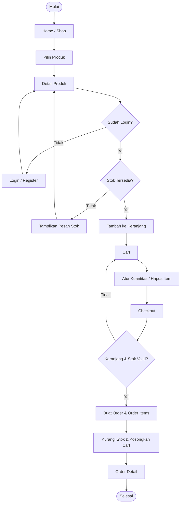
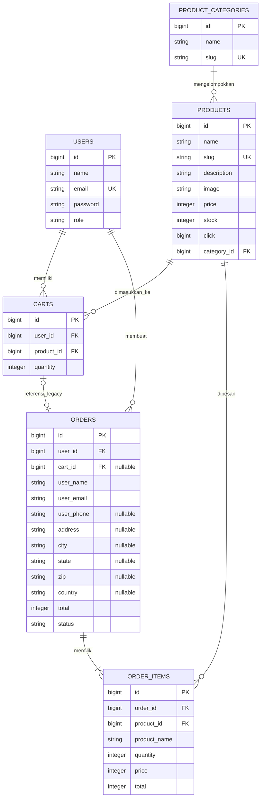

# Materi Presentasi — E-Commerce Website

> **Project:** E-Commerce Website
> **Repository:** `/home/user/GitHub/eduwork-batch-10/ecommerce10`
> **Dokumen:** `docs/PRESENTATION.md`
> **Tujuan:** Materi sumber untuk disusun menjadi slide PowerPoint.
> **Catatan:** Placeholder screenshot menunjukkan gambar yang perlu diambil dari aplikasi. Simpan hasil akhirnya pada folder `docs/screenshots/` sesuai nama file yang dicantumkan.

---

## Slide 1 — Judul Project

# E-Commerce Website

**Aplikasi toko online untuk menampilkan produk, mengelola keranjang belanja, dan mencatat pesanan pelanggan.**

- Nama Project: E-Commerce Website
- Nama Pembuat: [Nama Lengkap]
- Program: Eduwork — Batch 10
- Teknologi Utama: Laravel, PHP, MySQL, Blade, Tailwind CSS

**Visual:**
- [PLACEHOLDER: Screenshot halaman Home sebagai background/hero]
- Sumber halaman: `resources/views/home/index.blade.php`
- File screenshot: `docs/screenshots/01-homepage.png`

---

## Slide 2 — Deskripsi Project & Daftar Fitur

### Deskripsi Singkat

E-Commerce Website merupakan aplikasi toko online berbasis web. Pengunjung dapat melihat katalog produk dan detail produk. Pengguna yang sudah login dapat mengelola keranjang, melakukan checkout, serta melihat riwayat pesanan. Admin memiliki area khusus untuk mengelola produk, kategori, pesanan, dan melihat ringkasan performa toko.

### Fitur Utama

**Customer**
- Melihat halaman utama dan katalog produk.
- Menjelajahi produk berdasarkan kategori.
- Melihat detail, harga, dan stok produk.
- Mencari produk dari nama atau deskripsi.
- Registrasi, login, dan logout.
- Menambahkan produk ke keranjang.
- Mengubah jumlah atau menghapus item keranjang.
- Checkout dan membuat pesanan.
- Melihat daftar serta detail pesanan milik sendiri.
- Mengelola informasi profil dan password.

**Admin**
- Mengakses dashboard khusus admin.
- Melihat ringkasan jumlah produk, kategori, pesanan, dan klik produk.
- Melihat grafik jumlah pesanan per bulan dan distribusi status pesanan.
- Melihat produk dengan jumlah kunjungan detail tertinggi.
- CRUD produk dan kategori.
- Mencari, memfilter, dan mengurutkan produk.
- Upload dan menghapus gambar produk.
- Melihat seluruh pesanan dan detail pesanan.

**Batasan fitur saat ini**
- Checkout langsung membuat pesanan berstatus `pending`; belum ada integrasi payment gateway.
- Informasi telepon dan alamat pengiriman pada pesanan belum diisi melalui form checkout.
- Halaman admin dapat melihat pesanan, tetapi belum menyediakan aksi untuk mengubah status pesanan.
- Tombol wishlist pada detail produk masih berupa tampilan, belum memiliki proses penyimpanan wishlist.

---

## Slide 3 — Tools, Framework & Library

### Teknologi Backend
- **PHP 8.3+** — Bahasa pemrograman backend.
- **Laravel 13** — Framework aplikasi, routing, middleware, validation, dan ORM.
- **Eloquent ORM** — Relasi dan query database.
- **MySQL** — Database relasional utama.
- **Laravel Breeze** — Fondasi autentikasi.

### Teknologi Frontend
- **Laravel Blade** — Template halaman dan komponen UI.
- **Tailwind CSS 4** — Utility-first styling dan responsive layout.
- **Alpine.js** — Interaksi UI sederhana, termasuk kontrol jumlah produk.
- **Vite** — Build tool dan development server.
- **Lucide** — Ikon antarmuka.
- **Chart.js** — Grafik dashboard.
- **Pristine.js** — Validasi form sisi client.
- **Slugify** — Membantu pembuatan slug.
- **NProgress** — Indikator progres navigasi halaman.

### Tools Development & Testing
- Visual Studio Code
- Browser (Chrome/Firefox)
- Composer
- npm
- Laravel Artisan
- Pest — Feature testing

**File konfigurasi utama:**
- `composer.json`
- `package.json`
- `vite.config.js`
- `bootstrap/app.php`

---

## Slide 4 — Wireframe & Mockup Tampilan

> Gunakan screenshot aplikasi aktual jika halaman sudah tersedia. Jika belum, buat mockup dengan susunan komponen sesuai deskripsi. Setiap placeholder di bawah menyebutkan file Blade sumber agar halaman mudah ditemukan.

### 1. Home Page
- Isi: navbar, hero/banner, daftar kategori, daftar produk, pagination, footer.
- Route: `/`
- View: `resources/views/home/index.blade.php`
- Komponen: `resources/views/components/hero.blade.php`, `categories.blade.php`, `product-card.blade.php`
- [PLACEHOLDER SCREENSHOT: Home Page]
- Simpan sebagai: `docs/screenshots/02-home-page.png`
- Referensi screenshot lama: `.thumbnails/tugas_sesi_14_home.png`

### 2. Shop / Product Listing
- Isi: daftar produk, kategori, pencarian, pagination.
- Route: `/shop`
- View: `resources/views/home/shop.blade.php`
- [PLACEHOLDER SCREENSHOT: Shop / Product Listing]
- Simpan sebagai: `docs/screenshots/03-shop-page.png`

### 3. Product Description / Detail
- Isi: gambar produk, nama, harga, deskripsi, stok, pemilih kuantitas, tombol tambah ke keranjang.
- Route: `/product/{product}`
- View: `resources/views/product/description.blade.php`
- [PLACEHOLDER SCREENSHOT: Product Detail]
- Simpan sebagai: `docs/screenshots/04-product-detail.png`
- Referensi screenshot lama: `.thumbnails/tugas_sesi_14_product_detail.png`

### 4. Cart Page
- Isi: daftar item keranjang, kuantitas, subtotal, total belanja, tombol checkout.
- Route: `/cart`
- View: `resources/views/cart/index.blade.php`
- [PLACEHOLDER SCREENSHOT: Shopping Cart]
- Simpan sebagai: `docs/screenshots/05-cart-page.png`

### 5. Checkout Result / Order Detail
- Isi: nomor pesanan, status, item pesanan, total, informasi pemesan.
- Route: `/orders/{order}`
- View: `resources/views/orders/show.blade.php`
- [PLACEHOLDER SCREENSHOT: Order Detail setelah checkout]
- Simpan sebagai: `docs/screenshots/06-order-detail.png`

### 6. Login & Register
- Login: `/login` — `resources/views/auth/login.blade.php`
- Register: `/register` — `resources/views/auth/register.blade.php`
- [PLACEHOLDER SCREENSHOT: Login dan Register]
- Simpan sebagai:
  - `docs/screenshots/07-login.png`
  - `docs/screenshots/08-register.png`
- Referensi screenshot lama:
  - `.thumbnails/tugas_sesi_15_login.png`
  - `.thumbnails/tugas_sesi_15_register.png`

### 7. Admin Dashboard
- Isi: kartu statistik, grafik order bulanan, ringkasan status order, top viewed products.
- Route: `/dashboard`
- View: `resources/views/admin/dashboard.blade.php`
- [PLACEHOLDER SCREENSHOT: Admin Dashboard]
- Simpan sebagai: `docs/screenshots/09-admin-dashboard.png`
- Referensi screenshot lama: `.thumbnails/tugas_sesi_19_admin_dashboard.png`

### 8. Admin Product Management
- Isi: tabel produk, pencarian, filter kategori, sorting, tombol tambah/edit/hapus.
- Route: `/dashboard/products`
- View: `resources/views/admin/products/index.blade.php`
- Form create/edit:
  - `resources/views/admin/products/create.blade.php`
  - `resources/views/admin/products/edit.blade.php`
  - `resources/views/admin/products/_form.blade.php`
- [PLACEHOLDER SCREENSHOT: Product Management]
- Simpan sebagai: `docs/screenshots/10-admin-products.png`
- Referensi screenshot lama: `.thumbnails/tugas_sesi_16_products.png`

### 9. Admin Category Management
- Isi: tabel kategori dan dialog tambah/edit kategori.
- Route: `/dashboard/product-categories`
- View: `resources/views/admin/categories/index.blade.php`
- [PLACEHOLDER SCREENSHOT: Category Management]
- Simpan sebagai: `docs/screenshots/11-admin-categories.png`
- Referensi screenshot lama: `.thumbnails/tugas_sesi_16_product-categories.png`

### 10. Admin Order Management
- Isi: daftar seluruh pesanan dan detail pesanan pelanggan.
- Route:
  - `/dashboard/orders`
  - `/dashboard/orders/{order}`
- View:
  - `resources/views/admin/orders/index.blade.php`
  - `resources/views/admin/orders/show.blade.php`
- [PLACEHOLDER SCREENSHOT: Admin Order List & Detail]
- Simpan sebagai:
  - `docs/screenshots/12-admin-orders.png`
  - `docs/screenshots/13-admin-order-detail.png`

---

## Slide 5 — Screenshot Kode: Routing & Autentikasi

### A. Definisi Route Utama

Sumber: `routes/web.php`

```php
// Import controller yang menangani setiap fitur aplikasi.
use App\Http\Controllers\CartController;
use App\Http\Controllers\DashboardController;
use App\Http\Controllers\FileUploadController;
use App\Http\Controllers\HomeController;
use App\Http\Controllers\OrderController;
use App\Http\Controllers\ProductCategoryController;
use App\Http\Controllers\ProductController;
use App\Http\Controllers\ProfileController;
use Illuminate\Support\Facades\Route;

// Route publik: halaman Home, Shop, Cart, dan detail produk.
Route::get('/', [HomeController::class, 'index'])->name('home');
Route::get('/shop', [HomeController::class, 'shop'])->name('shop');
Route::get('/cart', [CartController::class, 'index'])->name('cart');
Route::get('/product/{product}', [HomeController::class, 'productDetail'])
    ->name('product-detail');

// Route untuk menambah, mengubah, dan menghapus item keranjang.
Route::post('/cart/{product}', [CartController::class, 'store'])->name('cart.store');
Route::patch('/cart/{cart}', [CartController::class, 'update'])->name('cart.update');
Route::delete('/cart/{cart}', [CartController::class, 'destroy'])->name('cart.destroy');

// Prefix dashboard dan middleware admin berlaku untuk semua route di dalam grup.
Route::prefix('/dashboard')->middleware(['admin'])->group(function () {
    // Halaman ringkasan dan analitik toko.
    Route::get('/', [DashboardController::class, 'index'])->name('dashboard');

    // Daftar semua pesanan dan halaman detail pesanan untuk admin.
    Route::get('/orders', [OrderController::class, 'adminIndex'])->name('orders.index');
    Route::get('/orders/{order}', [OrderController::class, 'adminShow'])->name('orders.show');

    // Resource route menyediakan endpoint CRUD produk dan kategori.
    Route::resource('products', ProductController::class);
    Route::resource('product-categories', ProductCategoryController::class);

    // Endpoint untuk upload dan menghapus gambar produk.
    Route::post('file-uploads', [FileUploadController::class, 'store'])->name('file-uploads.store');
    Route::delete('file-uploads', [FileUploadController::class, 'destroy'])->name('file-uploads.destroy');
});

// Grup auth hanya dapat diakses oleh pengguna yang sudah login.
Route::middleware('auth')->group(function () {
    // Route untuk melihat, mengubah, dan menghapus profil.
    Route::get('/profile', [ProfileController::class, 'edit'])->name('profile.edit');
    Route::patch('/profile', [ProfileController::class, 'update'])->name('profile.update');
    Route::delete('/profile', [ProfileController::class, 'destroy'])->name('profile.destroy');

    // Checkout membuat pesanan; customer hanya dapat membaca pesanan miliknya.
    Route::post('/checkout', [OrderController::class, 'store'])->name('checkout.store');
    Route::get('/orders', [OrderController::class, 'index'])->name('orders.customer.index');
    Route::get('/orders/{order}', [OrderController::class, 'show'])->name('orders.customer.show');
});

// Muat route autentikasi bawaan Laravel Breeze.
require __DIR__ . '/auth.php';
```

**Alur penjelasan:**
1. Import controller agar dapat dipanggil oleh route.
2. Route publik menghubungkan URL dengan halaman yang dapat diakses pengunjung.
3. Route cart menggunakan HTTP method POST, PATCH, dan DELETE sesuai operasinya.
4. Grup dashboard menerapkan middleware admin sebelum request mencapai controller.
5. Grup auth melindungi checkout, riwayat pesanan, dan pengelolaan profil.
6. File auth.php memuat route login, register, reset password, dan logout.

### B. Route Autentikasi

Sumber: `routes/auth.php`

```php
// Pengunjung yang belum login boleh membuka halaman login dan register.
Route::middleware('guest')->group(function () {
    // Tampilkan form registrasi.
    Route::get('register', [RegisteredUserController::class, 'create'])
        ->name('register');

    // Proses data registrasi dan buat akun baru.
    Route::post('register', [RegisteredUserController::class, 'store']);

    // Tampilkan form login.
    Route::get('login', [AuthenticatedSessionController::class, 'create'])
        ->name('login');

    // Periksa kredensial dan buat session login.
    Route::post('login', [AuthenticatedSessionController::class, 'store']);
});

// Hanya pengguna yang sudah login dapat melakukan logout.
Route::middleware('auth')->group(function () {
    // Akhiri session autentikasi pengguna.
    Route::post('logout', [AuthenticatedSessionController::class, 'destroy'])
        ->name('logout');
});
```

**Alur autentikasi:**
1. Middleware guest mencegah user yang sudah login membuka form login/register.
2. Method GET menampilkan halaman form.
3. Method POST mengirim data ke controller untuk diproses.
4. Jika login berhasil, Laravel menyimpan status autentikasi pada session.
5. Logout mengakhiri session pengguna.

**Screenshot kode yang perlu diambil:**
- `routes/web.php` — kelompok route publik, customer, dan admin.
- `routes/auth.php` — proses login, register, dan logout.

---

## Slide 6 — Screenshot Kode: Backend & Business Logic

### A. Filter Produk di Halaman Shop

Sumber: `app/Http/Controllers/HomeController.php`, method `shop()`.

```php
public function shop(Request $request)
{
    // Ambil kata kunci dan kategori dari query parameter URL.
    $search = $request->input('search');
    $category = $request->input('category');

    // Mulai query dari tabel products.
    $query = Product::query();

    // Jika ada kata kunci, cari pada nama atau deskripsi produk.
    if ($search) {
        $query->where('name', 'like', '%' . $search . '%')
            ->orWhere('description', 'like', '%' . $search . '%');
    }

    // Jika kategori dipilih, filter berdasarkan slug kategori.
    if ($category) {
        $category = trim($category);

        // whereHas memfilter produk berdasarkan relasi category.
        $query->whereHas('category', function ($q) use ($category) {
            $q->where('slug', $category);
        });
    }

    // Tampilkan produk yang stoknya masih tersedia.
    // with() memuat relasi kategori agar siap digunakan di Blade.
    // paginate(12) membatasi 12 produk per halaman.
    // withQueryString() mempertahankan filter saat berpindah halaman.
    $products = $query
        ->where('stock', '>', 0)
        ->with('category')
        ->paginate(12)
        ->withQueryString();

    // Ambil daftar kategori sekaligus jumlah produk per kategori.
    $categories = ProductCategory::withCount('products')->get();

    // Kirim seluruh data yang dibutuhkan ke halaman Shop.
    return view('home.shop', compact('products', 'search', 'category', 'categories'));
}
```

**Alur penjelasan:**
1. Baca parameter pencarian dan kategori dari URL.
2. Susun query produk sesuai filter yang dimasukkan.
3. whereHas memanfaatkan relasi Eloquent untuk filter kategori.
4. with memuat relasi kategori untuk menghindari query berulang di view.
5. paginate membagi hasil menjadi 12 produk per halaman.
6. Kirim data ke Blade untuk ditampilkan.

> Catatan teknis: implementasi saat ini menggunakan where() lalu orWhere() untuk pencarian nama/deskripsi. Jika filter kategori dan stok harus selalu berlaku pada kedua kondisi pencarian, kelompokkan pencarian dengan closure where(function ($q) { ... }).

### B. Menambahkan Produk ke Keranjang

Sumber: `app/Http/Controllers/CartController.php`, method `store()`.

```php
public function store(Request $request, Product $product): RedirectResponse
{
    // Pastikan pengguna login sebelum menambahkan item ke cart.
    if (! Auth::check()) {
        return redirect()->route('login', [
            'redirect_to' => route('product-detail', $product, absolute: false)
        ])->with('error', 'Silakan masuk terlebih dahulu.');
    }

    // Validasi kuantitas dari form detail produk.
    $validated = $request->validate([
        'quantity' => ['required', 'integer', 'min:1'],
    ]);

    // Tolak produk yang stoknya sudah habis.
    if ($product->stock < 1) {
        return back()->with('error', 'Maaf, produk ini sedang habis.');
    }

    // Jalankan perubahan cart di dalam transaksi database.
    $stockError = DB::transaction(function () use ($product, $validated): ?int {

        // Kunci baris produk agar perubahan bersamaan tidak menyebabkan overselling.
        $lockedProduct = Product::query()->lockForUpdate()->findOrFail($product->id);

        // Cari item cart milik user untuk produk yang sama.
        // Baris cart dikunci selama transaksi berlangsung.
        $cartItem = Cart::query()
            ->where('user_id', Auth::id())
            ->where('product_id', $lockedProduct->id)
            ->lockForUpdate()
            ->first();

        // Jika item sudah ada, jumlah baru adalah jumlah lama + input baru.
        // Jika belum ada, jumlah lama dianggap nol.
        $newQuantity = ($cartItem?->quantity ?? 0) + $validated['quantity'];

        // Pastikan jumlah yang diminta tidak melebihi stok.
        if ($newQuantity > $lockedProduct->stock) {
            return $lockedProduct->stock;
        }

        // Jika item ditemukan, perbarui kuantitasnya.
        if ($cartItem) {
            $cartItem->quantity = $newQuantity;
            $cartItem->save();
        } else {
            // Jika belum ada, buat item cart baru.
            Cart::query()->create([
                'user_id' => Auth::id(),
                'product_id' => $lockedProduct->id,
                'quantity' => $validated['quantity'],
            ]);
        }

        // Null menandakan proses berhasil tanpa masalah stok.
        return null;
    });

    // Jika stok tidak mencukupi, tampilkan pesan kesalahan.
    if ($stockError !== null) {
        return back()->with('error', "Jumlah melebihi stok tersedia ({$stockError}).");
    }

    // Arahkan user ke halaman cart setelah berhasil.
    return redirect()->route('cart')
        ->with('success', 'Produk berhasil ditambahkan ke keranjang.');
}
```

**Alur penjelasan:**
1. Periksa autentikasi user.
2. Validasi input kuantitas.
3. Periksa stok awal produk.
4. Mulai transaksi database.
5. Kunci data produk dan cart menggunakan lockForUpdate().
6. Hitung kuantitas baru dan bandingkan dengan stok.
7. Update item yang sudah ada atau insert item baru.
8. Jika transaksi berhasil, arahkan user ke halaman cart.

### C. Checkout & Pembuatan Pesanan

Sumber: `app/Http/Controllers/OrderController.php`, method `store()`.

```php
public function store(Request $request): RedirectResponse
{
    // Bungkus seluruh checkout dalam satu transaksi database.
    // Jika salah satu langkah gagal, perubahan akan di-rollback.
    $order = DB::transaction(function (): Order {

        // Ambil cart milik user yang login dan kunci barisnya.
        $cartItems = Cart::query()
            ->where('user_id', Auth::id())
            ->lockForUpdate()
            ->get();

        // Validasi: checkout tidak boleh dilakukan jika cart kosong.
        if ($cartItems->isEmpty()) {
            throw ValidationException::withMessages([
                'cart' => 'Keranjang belanja kosong. Tambahkan produk sebelum checkout.',
            ]);
        }

        // Siapkan penampung detail pesanan dan total belanja.
        $orderLines = [];
        $total = 0;

        // Proses seluruh produk yang ada di keranjang.
        foreach ($cartItems as $cartItem) {

            // Ambil dan kunci produk untuk pemeriksaan stok terakhir.
            $product = Product::query()
                ->lockForUpdate()
                ->find($cartItem->product_id);

            // Validasi produk masih ada dan jumlah pesanan tidak melebihi stok.
            if (! $product || $cartItem->quantity < 1 || $cartItem->quantity > $product->stock) {
                throw ValidationException::withMessages([
                    'cart' => 'Stok produk ' . ($product?->name ?? 'yang dipilih')
                        . ' tidak mencukupi. Perbarui keranjang lalu coba lagi.',
                ]);
            }

            // Hitung subtotal satu jenis produk.
            $lineTotal = (int) $product->price * (int) $cartItem->quantity;

            // Tambahkan subtotal ke total keseluruhan pesanan.
            $total += $lineTotal;

            // Simpan snapshot nama, harga, kuantitas, dan subtotal produk.
            $orderLines[] = [
                'product_id' => $product->id,
                'product_name' => $product->name,
                'quantity' => $cartItem->quantity,
                'price' => $product->price,
                'total' => $lineTotal,
            ];
        }

        // Ambil data customer yang sedang checkout.
        $user = Auth::user();

        // Buat record utama pesanan pada tabel orders.
        // Status awal pesanan adalah pending.
        // cart_id dan data pengiriman belum diisi pada versi saat ini.
        $order = Order::query()->create([
            'user_id' => $user->id,
            'cart_id' => null,
            'user_name' => $user->name,
            'user_email' => $user->email,
            'user_phone' => null,
            'address' => null,
            'city' => null,
            'state' => null,
            'zip' => null,
            'country' => null,
            'total' => $total,
            'status' => 'pending',
        ]);

        // Buat seluruh baris detail pesanan pada tabel order_items.
        $order->orderItems()->createMany($orderLines);

        // Kurangi stok setiap produk sesuai jumlah yang dipesan.
        foreach ($cartItems as $cartItem) {
            Product::query()
                ->whereKey($cartItem->product_id)
                ->decrement('stock', $cartItem->quantity);
        }

        // Kosongkan cart setelah order dan detailnya berhasil disimpan.
        Cart::query()->where('user_id', $user->id)->delete();

        // Kembalikan object order dari transaksi.
        return $order;
    });

    // Arahkan customer ke detail pesanan yang baru dibuat.
    return redirect()->route('orders.customer.show', $order)
        ->with('success', 'Pesanan berhasil dibuat. Pesanan Anda sudah tercatat.');
}
```

**Alur penjelasan:**
1. Mulai transaksi database.
2. Ambil dan kunci cart milik user.
3. Tolak checkout jika cart kosong.
4. Periksa ulang produk dan stok terbaru satu per satu.
5. Hitung subtotal setiap item dan total pesanan.
6. Siapkan orderLines sebagai snapshot detail produk.
7. Buat satu record utama di tabel orders.
8. Buat banyak record detail melalui createMany() ke order_items.
9. Kurangi stok produk.
10. Hapus cart user setelah pesanan tersimpan.
11. Redirect ke halaman detail pesanan.

**Istilah penting:**
- DB::transaction() — memastikan seluruh langkah berhasil bersama atau dibatalkan bersama.
- lockForUpdate() — mengunci baris database selama transaksi.
- create() — membuat satu record baru.
- createMany() — membuat beberapa record pada relasi.
- decrement() — mengurangi nilai stok langsung di database.
- ValidationException — menghentikan proses dan mengembalikan pesan validasi.

> Untuk screenshot, fokuskan pada keseluruhan method store() di OrderController.php. Jika terlalu panjang, pecah menjadi dua screenshot: (1) validasi cart, stok, dan perhitungan total; (2) pembuatan order, order items, pengurangan stok, dan pengosongan cart.

---

## Slide 7 — Screenshot Kode: Admin, Upload & Analytics

### A. Proteksi Akses Admin

Sumber: `app/Http/Middleware/AdminMiddleware.php`

```php
class AdminMiddleware
{
    public function handle(Request $request, Closure $next): Response
    {
        // Pastikan user sudah login dan memiliki role admin.
        if (Auth::check() && Auth::user()->role === 'admin') {

            // Jika lolos pemeriksaan, teruskan request ke controller.
            return $next($request);
        }

        // Jika bukan admin, arahkan kembali ke Home dengan pesan error.
        return redirect()->route('home')
            ->with('error', 'You are not authorized to access this page.');
    }
}
```

Pendaftaran alias middleware di `bootstrap/app.php`:

```php
// Daftarkan alias admin agar dapat digunakan pada definisi route.
$middleware->alias([
    'admin' => AdminMiddleware::class,
]);
```

**Alur penjelasan:**
1. Request melewati middleware sebelum controller dijalankan.
2. Auth::check() memeriksa apakah user sudah login.
3. Auth::user()->role memeriksa role akun.
4. Jika role admin, request diteruskan dengan $next($request).
5. Jika tidak memenuhi syarat, user diarahkan ke Home.

### B. Validasi & Penyimpanan Produk

Sumber: `app/Http/Controllers/ProductController.php`, method `store()`.

```php
public function store(Request $request): RedirectResponse
{
    // Validasi seluruh data yang dikirim dari form tambah produk.
    $validated = $request->validate([
        // Nama produk wajib diisi dan maksimal 255 karakter.
        'name' => ['required', 'string', 'max:255'],

        // Slug harus unik agar URL produk tidak bertabrakan.
        'slug' => ['required', 'string', 'max:255', 'unique:products,slug'],

        // Deskripsi produk wajib diisi.
        'description' => ['required', 'string', 'max:255'],

        // Field image berisi path gambar yang sudah diunggah.
        'image' => ['required', 'string', 'max:255'],

        // Harga dan stok harus integer dan tidak boleh negatif.
        'price' => ['required', 'integer', 'min:0'],
        'stock' => ['required', 'integer', 'min:0'],

        // Pastikan kategori yang dipilih tersedia di tabel kategori.
        'category_id' => ['required', 'integer', 'exists:product_categories,id'],
    ]);

    // Simpan data yang sudah lolos validasi ke tabel products.
    Product::create($validated);

    // Kembali ke daftar produk dengan notifikasi sukses.
    return redirect()
        ->route('products.index')
        ->with('success', 'Product created successfully.');
}
```

**Alur penjelasan:**
1. Form mengirim data produk ke method store().
2. Laravel memvalidasi seluruh field.
3. Jika gagal, Laravel mengembalikan user ke form dengan pesan error.
4. Jika valid, Eloquent menyimpan data menggunakan Product::create().
5. Admin kembali ke daftar produk dan melihat notifikasi sukses.

### C. Upload Gambar Produk

Sumber: `app/Http/Controllers/FileUploadController.php`, method `store()`.

```php
public function store(Request $request): JsonResponse
{
    // Validasi file: wajib berupa file dengan format yang diizinkan.
    // Batas ukuran file adalah 2048 KB atau 2 MB.
    $request->validate([
        'file' => [
            'required',
            'file',
            'mimes:jpg,jpeg,png,gif,webp',
            'max:2048',
        ],
    ]);

    // Ambil file yang dikirim melalui request.
    $file = $request->file('file');

    // Simpan file ke folder uploads pada disk public.
    $path = $file->store('uploads', 'public');

    // Kembalikan path dan informasi file dalam format JSON ke frontend.
    return response()->json([
        'path' => $path,
        'url' => '/storage/' . $path,
        'name' => $file->getClientOriginalName(),
        'size' => $file->getSize(),
        'extension' => strtolower(
            $file->extension() ?: $file->getClientOriginalExtension()
        ),
    ]);
}
```

**Alur penjelasan:**
1. Frontend mengirim file ke endpoint upload.
2. Backend memvalidasi format dan ukuran file.
3. Laravel Storage menyimpan file pada disk public.
4. Backend mengembalikan path dan URL dalam JSON.
5. Frontend menggunakan path tersebut ketika menyimpan data produk.

### D. Statistik Dashboard

Sumber: `app/Http/Controllers/DashboardController.php`, method `index()`.

```php
public function index()
{
    // Hitung total produk, kategori, pesanan, dan klik produk.
    $totalProducts = Product::count();
    $totalCategories = ProductCategory::count();
    $totalOrders = Order::count();
    $totalProductClicks = (int) Product::sum('click');

    // Siapkan nilai untuk empat kartu statistik dashboard.
    $metrics = [
        ['label' => 'Total Products', 'value' => $totalProducts, 'icon' => 'package'],
        ['label' => 'Total Product Clicks', 'value' => $totalProductClicks, 'icon' => 'mouse-pointer-click'],
        ['label' => 'Total Categories', 'value' => $totalCategories, 'icon' => 'tag'],
        ['label' => 'Total Orders', 'value' => $totalOrders, 'icon' => 'shopping-bag'],
    ];

    // Pilih fungsi ekstraksi bulan sesuai driver database.
    $monthExpression = DB::connection()->getDriverName() === 'sqlite'
        ? "CAST(strftime('%m', created_at) AS INTEGER)"
        : 'MONTH(created_at)';

    // Hitung jumlah order per bulan pada tahun berjalan.
    $monthlyOrders = Order::query()
        ->whereYear('created_at', now()->year)
        ->selectRaw($monthExpression . ' as month, COUNT(*) as total')
        ->groupBy('month')
        ->pluck('total', 'month');

    // Siapkan 12 label bulan dan isi bulan tanpa order dengan angka nol.
    $ordersChart = [
        'labels' => ['Jan', 'Feb', 'Mar', 'Apr', 'May', 'Jun',
                     'Jul', 'Aug', 'Sep', 'Oct', 'Nov', 'Dec'],
        'orders' => collect(range(1, 12))
            ->map(fn (int $month) => (int) ($monthlyOrders[$month] ?? 0))
            ->all(),
    ];

    // Ambil lima produk dengan klik tertinggi, lalu bentuk data yang dibutuhkan view.
    $products_clicks = Product::query()
        ->orderByDesc('click')
        ->orderByDesc('id')
        ->limit(5)
        ->get()
        ->map(fn (Product $product) => [
            'image' => $product->image,
            'label' => $product->name,
            'url' => route('product-detail', $product),
            'clicks' => (int) $product->click,
        ])
        ->all();

    // Hitung jumlah order berdasarkan status pada tabel orders.
    // (Detail query order_statuses disingkat pada contoh presentasi.)
    $order_statuses = /* hasil agregasi order berdasarkan status */ [];

    // Gabungkan data line chart dan doughnut chart untuk dikirim ke JavaScript.
    $chart_data = [
        'orders' => $ordersChart,
        'order_statuses' => $order_statuses,
    ];

    // Kirim data statistik, produk populer, dan data chart ke Blade.
    return view('admin.dashboard', compact(
        'metrics',
        'products_clicks',
        'order_statuses',
        'chart_data',
    ));
}
```

**Alur penjelasan:**
1. Query agregasi menghitung total produk, kategori, pesanan, dan klik.
2. Query bulanan menghitung jumlah order berdasarkan bulan pada tahun berjalan.
3. Bulan yang belum memiliki pesanan diisi angka nol.
4. Produk diurutkan berdasarkan jumlah klik tertinggi.
5. Controller juga menghitung distribusi status pesanan.
6. Data statistik dan chart dikirim ke Blade untuk ditampilkan.

> Potongan ini disederhanakan untuk presentasi. Screenshot kode aktual sebaiknya juga memperlihatkan bagian perhitungan order_statuses dan chart_data agar terlihat bagaimana data status pesanan dikirim ke frontend.

### E. Rendering Grafik Dashboard

Sumber: `resources/js/dashboard.js`.

```js
// Import controller, elemen, scale, dan plugin Chart.js yang diperlukan.
import {
    ArcElement,
    CategoryScale,
    Chart,
    DoughnutController,
    Filler,
    LinearScale,
    LineController,
    LineElement,
    PointElement,
    Tooltip,
} from "chart.js";

// Registrasikan komponen Chart.js sebelum membuat grafik.
Chart.register(
    ArcElement,
    CategoryScale,
    DoughnutController,
    Filler,
    LinearScale,
    LineController,
    LineElement,
    PointElement,
    Tooltip,
);

// Ambil data JSON yang disisipkan oleh Blade ke halaman dashboard.
function getDashboardData() {
    const element = document.getElementById("dashboard-chart-data");

    // Jika elemen tidak ditemukan, hentikan proses.
    if (!element) return null;

    // Ubah teks JSON menjadi object JavaScript.
    try {
        return JSON.parse(element.textContent);
    } catch (error) {
        console.error("Unable to parse dashboard chart data.", error);
        return null;
    }
}

// Buat line chart untuk menampilkan jumlah order setiap bulan.
function createOrdersChart(canvas, orders) {
    new Chart(canvas, {
        type: "line",
        data: {
            labels: orders.labels,
            datasets: [{
                label: "Orders",
                data: orders.orders,
            }],
        },
        options: {
            responsive: true,
            maintainAspectRatio: false,
        },
    });
}

// Buat doughnut chart untuk menampilkan distribusi status order.
function createOrderStatusChart(canvas, statuses) {
    new Chart(canvas, {
        type: "doughnut",
        data: {
            // Ambil nama status sebagai label setiap bagian grafik.
            labels: statuses.map((status) => status.name),
            datasets: [{
                // Ambil jumlah order dan warna untuk setiap status.
                data: statuses.map((status) => status.value),
                backgroundColor: statuses.map((status) => status.color),
            }],
        },
        options: {
            responsive: true,
            maintainAspectRatio: false,
        },
    });
}

// Inisialisasi seluruh grafik ketika data dan elemen canvas tersedia.
function initializeDashboard() {
    const data = getDashboardData();

    if (!data) return;

    // Temukan canvas untuk grafik order dan status.
    const ordersCanvas = document.getElementById("orders-chart");
    const statusCanvas = document.getElementById("order-status-chart");

    // Hapus instance sebelumnya, lalu render line chart terbaru.
    if (ordersCanvas && data.orders) {
        Chart.getChart(ordersCanvas)?.destroy();
        createOrdersChart(ordersCanvas, data.orders);
    }

    // Hapus instance sebelumnya, lalu render doughnut chart terbaru.
    if (statusCanvas && data.order_statuses) {
        Chart.getChart(statusCanvas)?.destroy();
        createOrderStatusChart(statusCanvas, data.order_statuses);
    }
}

// Bersihkan instance chart sebelum Boost mengganti konten halaman.
function destroyDashboardCharts() {
    const ordersCanvas = document.getElementById("orders-chart");
    const statusCanvas = document.getElementById("order-status-chart");

    if (ordersCanvas) Chart.getChart(ordersCanvas)?.destroy();
    if (statusCanvas) Chart.getChart(statusCanvas)?.destroy();
}

// Integrasi dengan event Boost HTML untuk navigasi tanpa reload penuh.
document.addEventListener("boost:before-swap", destroyDashboardCharts);
document.addEventListener("boost:page-ready", initializeDashboard);

// Inisialisasi awal: tunggu DOM jika dokumen masih dalam proses loading.
if (document.readyState === "loading") {
    document.addEventListener("DOMContentLoaded", initializeDashboard, { once: true });
} else {
    // Jika DOM sudah siap, langsung inisialisasi grafik.
    initializeDashboard();
}
```

**Alur penjelasan:**
1. Import dan registrasi modul Chart.js.
2. Ambil data JSON yang dikirim oleh Blade.
3. Parse JSON menjadi object JavaScript.
4. Cari elemen canvas untuk setiap grafik.
5. Render line chart untuk jumlah order bulanan.
6. Render doughnut chart untuk distribusi status pesanan.
7. Hapus instance chart sebelumnya agar tidak terjadi duplikasi.

> Potongan JavaScript di atas disederhanakan untuk menjelaskan konsep. Implementasi aktual juga menangani event Boost HTML (boost:before-swap dan boost:page-ready) agar chart dibersihkan dan diinisialisasi ulang saat navigasi halaman tanpa reload penuh.

**Screenshot kode yang perlu diambil:**
- `AdminMiddleware.php` — pemeriksaan role admin.
- `bootstrap/app.php` — pendaftaran alias middleware.
- `ProductController.php` — validasi dan penyimpanan produk.
- `FileUploadController.php` — validasi dan penyimpanan gambar.
- `DashboardController.php` — agregasi data dashboard.
- `resources/js/dashboard.js` — parsing data dan rendering chart.

---

## Slide 8 — User Flow

### A. Customer Flow

- Pengunjung membuka halaman Home.
  - Melihat hero, kategori, dan produk.
- Pengunjung membuka halaman Shop.
  - Mencari produk.
  - Memilih kategori.
  - Membuka detail produk.
- Pengunjung menekan tombol Tambah ke Keranjang.
  - Jika belum login, diarahkan untuk login.
  - Jika stok tidak mencukupi, sistem menampilkan pesan error.
  - Jika valid, produk disimpan ke keranjang.
- Customer membuka halaman Cart.
  - Mengubah kuantitas produk.
  - Menghapus produk jika diperlukan.
  - Memeriksa total belanja.
- Customer menekan Checkout.
  - Sistem memvalidasi keranjang dan stok terbaru.
  - Sistem membuat order dan order items.
  - Sistem mengurangi stok produk.
  - Sistem menghapus item keranjang.
- Customer melihat halaman detail pesanan.
  - Customer dapat membuka riwayat pesanan.
  - Customer dapat melihat detail order miliknya.

### B. Admin Flow

- Admin membuka halaman Login.
- Admin berhasil login dengan akun ber-role `admin`.
- Admin masuk ke Dashboard.
  - Melihat total produk, kategori, pesanan, dan klik produk.
  - Melihat grafik jumlah pesanan bulanan.
  - Melihat ringkasan status pesanan.
  - Melihat produk dengan klik terbanyak.
- Admin membuka Product Management.
  - Melihat daftar produk.
  - Mencari, memfilter, dan mengurutkan produk.
  - Menambah produk.
  - Mengedit produk.
  - Menghapus produk.
- Admin membuka Category Management.
  - Menambah kategori.
  - Mengedit kategori.
  - Menghapus kategori.
- Admin membuka Order Management.
  - Melihat seluruh pesanan.
  - Membuka detail pesanan pelanggan.
- Admin logout.

### C. Diagram Alur Customer



---

## Slide 9 — ERD (Entity Relationship Diagram)

### Struktur Database

Database utama terdiri dari enam entitas:

- `users` — menyimpan akun customer dan admin.
- `product_categories` — menyimpan kategori produk.
- `products` — menyimpan katalog, harga, stok, dan jumlah klik.
- `carts` — menyimpan item keranjang milik user.
- `orders` — menyimpan data transaksi/pesanan.
- `order_items` — menyimpan rincian produk pada setiap pesanan.

### Diagram ERD



### Penjelasan Relasi

- Satu user dapat memiliki banyak cart item.
- Satu user dapat membuat banyak order.
- Satu kategori dapat memiliki banyak produk.
- Satu produk dapat muncul pada banyak cart item.
- Satu order memiliki satu atau lebih order item.
- Satu produk dapat tercatat pada banyak order item.
- `orders.cart_id` bersifat nullable untuk kompatibilitas data lama; checkout saat ini membuat order dengan `cart_id = null`. Relasi ini bukan sumber utama rincian transaksi.
- `order_items` menyimpan `product_name` dan `price` sebagai snapshot saat checkout agar rincian historis tetap tersedia.

**Sumber struktur:** `database/migrations/` dan `app/Models/`.

---

## Slide 10 — Demo Project

### Urutan Demo yang Disarankan

**1. Halaman Publik**
- Buka Home dan tunjukkan hero, kategori, serta daftar produk.
- Buka Shop.
- Cari produk menggunakan kata kunci.
- Filter produk berdasarkan kategori.
- Buka detail salah satu produk.
- Tunjukkan harga, stok, deskripsi, dan pemilih kuantitas.

**2. Autentikasi Customer**
- Registrasi akun baru atau login sebagai customer.
- Tunjukkan navigasi setelah login.
- Jelaskan pembatasan akses halaman yang membutuhkan autentikasi.

**3. Keranjang & Checkout**
- Tambahkan produk ke keranjang.
- Tambahkan produk yang sama lagi untuk menunjukkan penggabungan kuantitas.
- Ubah kuantitas di halaman cart.
- Hapus salah satu item.
- Checkout.
- Tunjukkan halaman detail pesanan yang berhasil dibuat.
- Tunjukkan stok produk berkurang dan keranjang menjadi kosong.

**4. Riwayat Pesanan**
- Buka halaman Pesanan Saya.
- Tunjukkan nomor order, tanggal, jumlah item, total, dan status.
- Buka detail order.
- Jelaskan bahwa user hanya dapat mengakses pesanan miliknya.

**5. Admin Dashboard**
- Logout dari customer dan login sebagai admin.
- Buka Dashboard.
- Tunjukkan total produk, kategori, order, dan klik produk.
- Tunjukkan grafik order per bulan.
- Tunjukkan distribusi status order.
- Tunjukkan daftar produk dengan klik tertinggi.

**6. Manajemen Produk**
- Buka daftar produk.
- Coba pencarian, filter kategori, dan sorting.
- Tambahkan produk baru beserta gambar.
- Edit harga atau stok produk.
- Hapus produk jika aman untuk data demo.

**7. Manajemen Kategori**
- Buka daftar kategori.
- Tambahkan kategori.
- Edit nama atau slug kategori.
- Tunjukkan jumlah produk per kategori.
- Hapus kategori hanya jika tidak memiliki produk terkait.

**8. Manajemen Pesanan**
- Buka daftar seluruh order pada admin.
- Buka salah satu detail order.
- Tunjukkan informasi customer, item, kuantitas, subtotal, total, dan status.
- Jelaskan bahwa perubahan status belum tersedia pada versi saat ini.

### Checklist Persiapan Demo

- [ ] Pastikan aplikasi dapat diakses dan database berjalan.
- [ ] Jalankan seeder atau siapkan data demo yang cukup.
- [ ] Siapkan akun customer dan admin.
- [ ] Siapkan beberapa kategori dan produk dengan stok yang cukup.
- [ ] Siapkan satu produk dengan stok terbatas untuk demo validasi stok.
- [ ] Pastikan storage link aktif agar gambar produk tampil.
- [ ] Pastikan grafik dashboard memiliki data pesanan.
- [ ] Siapkan browser dalam kondisi logout sebelum demo customer.
- [ ] Pastikan tidak ada data pribadi atau kredensial asli yang tampil saat presentasi.

### Akun Demo

Isi setelah akun demo dipastikan tersedia. Jangan menampilkan password akun pribadi pada slide.

- Customer: [Email akun demo]
- Admin: [Email akun demo]

---

## Slide 11 — Penutup

### Kesimpulan

E-Commerce Website telah mengimplementasikan alur utama toko online, mulai dari penampilan katalog produk, autentikasi pengguna, pengelolaan keranjang, checkout, hingga pencatatan dan pemantauan pesanan.

Dari sisi admin, aplikasi menyediakan pengelolaan produk dan kategori, proteksi akses berdasarkan role, serta dashboard untuk memantau ringkasan aktivitas toko.

### Pengembangan Selanjutnya

- Menambahkan form alamat dan nomor telepon pada checkout.
- Integrasi payment gateway.
- Menambahkan aksi perubahan status pesanan untuk admin.
- Menambahkan notifikasi status pesanan.
- Mengimplementasikan wishlist.
- Menambahkan pengelolaan pengiriman dan pelacakan pesanan.

**Terima kasih.**

---

## Catatan Produksi PowerPoint

1. Gunakan satu slide untuk setiap heading `Slide N`.
2. Slide wireframe sebaiknya menggunakan screenshot aktual dengan ukuran besar; jangan memasukkan seluruh path file ke tampilan presentasi final.
3. Path file dan catatan implementasi pada dokumen ini berfungsi sebagai panduan pembuat PPT.
4. Untuk slide kode, ambil screenshot dari file sumber dengan font editor yang cukup besar. Potongan kode dalam dokumen dapat dipakai sebagai acuan, bukan harus ditampilkan seluruhnya.
5. Untuk ERD, render diagram Mermaid menjadi gambar atau buat ulang menggunakan tool diagram agar terbaca di PowerPoint.
6. Jangan menyatakan fitur payment gateway, update status order, wishlist, atau pengisian alamat checkout sudah tersedia karena belum diimplementasikan pada versi yang diperiksa.
